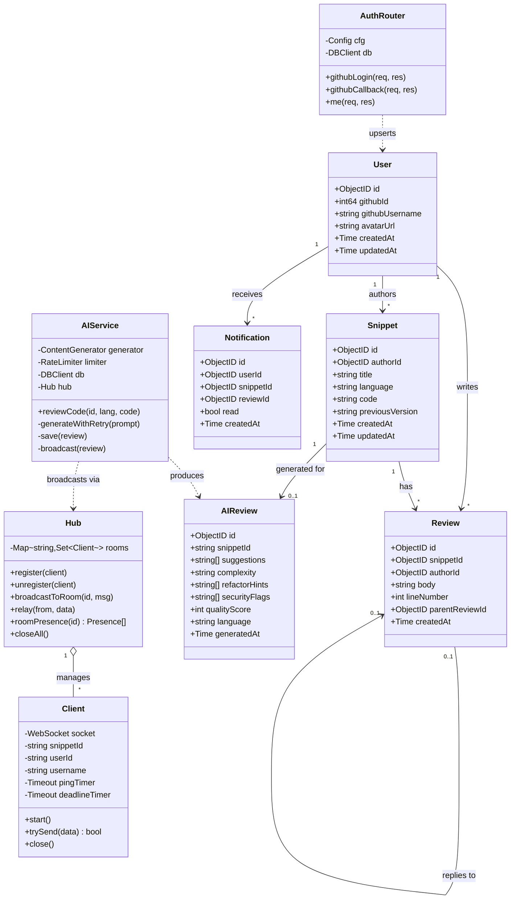
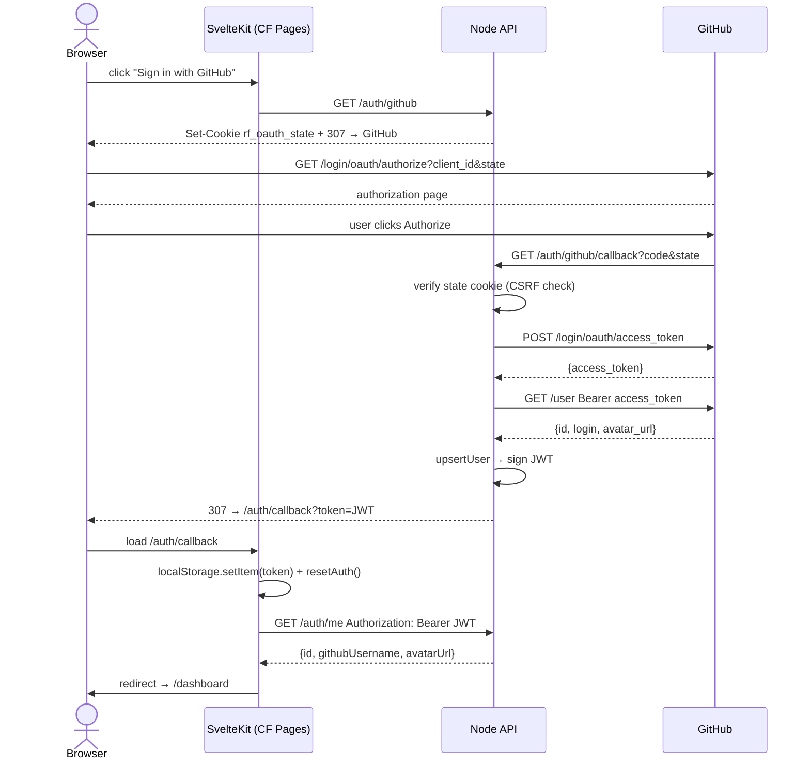
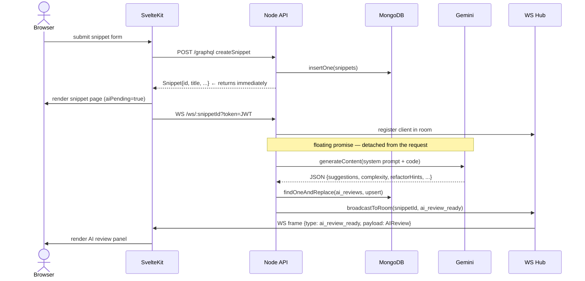
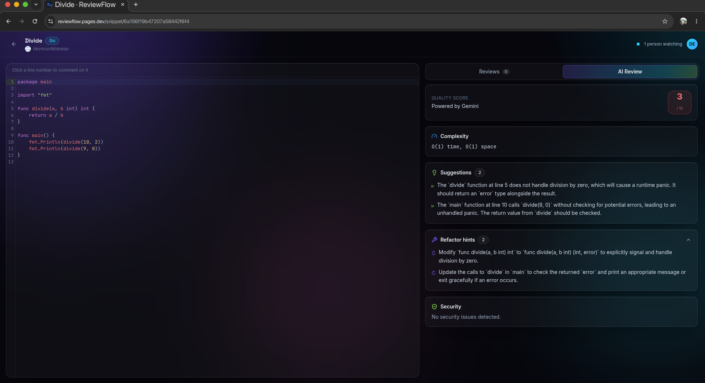
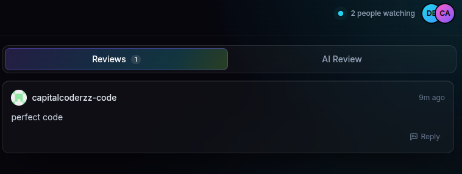

# ReviewFlow

> Real-time, multiplayer code review with an AI in the room.

ReviewFlow is a self-hostable code-review platform: drop in a snippet, share
the link, and watch reviews stream in live while Google Gemini analyses the
code in the background. It pairs a Node.js (Express + TypeScript) backend with
a Svelte 5 frontend over GraphQL and a hand-rolled WebSocket hub.

Built by [Souvik Biswas](https://souvikbiswas-portfolio.pages.dev)

---

## Architecture

```
                ┌───────────────────────────────┐
                │     SvelteKit SPA (Svelte 5)  │
                │  CodeMirror 6 · diff2html     │
                │  urql · native WebSocket      │
                └──────┬───────────────┬────────┘
                       │ HTTPS         │ WSS
                       ▼               ▼
                ┌──────────────────────────────┐
                │       Caddy (edge)           │
                │  · serves SPA               │
                │  · reverse-proxy /graphql,  │
                │    /auth, /ws, /notifications│
                │  · Let's Encrypt, CSP, HSTS │
                └──────────────┬───────────────┘
                               │ http :8080
                               ▼
            ┌──────────────────────────────────────┐
            │   Node backend (Express + graphql-js) │
            │  · GraphQL resolvers (snippets,      │
            │    reviews, AI review field)         │
            │  · WebSocket room hub (Map of rooms, │
            │    single-threaded event loop)       │
            │  · JWT auth, GitHub OAuth            │
            │  · Notifications REST endpoint       │
            └────┬───────────────────────┬─────────┘
                 │                       │
                 ▼                       ▼
        ┌────────────────┐      ┌──────────────────┐
        │   MongoDB 7    │      │  Gemini 2.5      │
        │   users        │      │  Flash (free)    │
        │   snippets     │      │  · async pipeline│
        │   reviews      │      │  · structured    │
        │   ai_reviews   │      │    JSON output   │
        │   notifications│      │  · rate-limited  │
        └────────────────┘      └──────────────────┘
```

---

## Low-level design

### Class diagram



### Sequence diagrams

#### GitHub OAuth login



#### Snippet creation + async AI review



---

## Tech stack

| Layer        | Choice                                                         |
| ------------ | -------------------------------------------------------------- |
| Frontend     | SvelteKit (Svelte 5 runes) · TypeScript · Tailwind CSS         |
| Editor       | CodeMirror 6 · diff2html · jsdiff                              |
| GraphQL      | `@urql/svelte` on the client · `graphql-js` + `graphql-http`   |
| Realtime     | Native browser WebSocket ↔ `ws` room hub                       |
| Backend      | Node 24 · TypeScript · Express 5 · `jsonwebtoken` · `mongodb`  |
| AI           | Google Gemini 2.5 Flash via `@google/genai`                    |
| Rate limit   | Hand-rolled token bucket (10 req/min, under free-tier quota)   |
| Auth         | GitHub OAuth → HttpOnly session cookie (+ Bearer token)        |
| Database     | MongoDB 7 (auth enabled in production)                         |
| Edge / TLS   | Caddy 2 — automatic Let's Encrypt                              |
| Packaging    | Docker · multi-stage builds · non-root runtime image           |

---

## Local development

You only need Docker.

```bash
# 1. Clone, then configure
git clone https://github.com/<you>/reviewflow.git
cd reviewflow
cp .env.example .env

# 2. (recommended) add a GitHub OAuth app + Gemini key
#    GitHub: https://github.com/settings/developers
#      Homepage URL:              http://localhost:5173
#      Authorization callback URL: http://localhost:8080/auth/github/callback
#    Gemini key (free tier):     https://aistudio.google.com/apikey
#    Then edit .env to fill in GITHUB_CLIENT_ID/SECRET, JWT_SECRET, GEMINI_API_KEY

# 3. Start the backend stack (Node + MongoDB, with hot reload via node --watch)
docker compose up
# -> backend on :8080, /health returns {"status":"ok","db":"connected"}
#
#    Prefer running the server on the host? Point MONGO_URI at localhost and:
#      cd server && npm install && npm run dev

# 4. In another shell, start the frontend dev server
cd web
cp .env.example .env          # PUBLIC_API_URL=http://localhost:8080
npm install
npm run dev                   # -> http://localhost:5173
```

Open <http://localhost:5173>, sign in with GitHub, create a snippet, and a
Gemini AI review appears moments later.

### Useful commands

| Command                                                    | What it does                                  |
| ---------------------------------------------------------- | --------------------------------------------- |
| `docker compose up`                                        | Backend + MongoDB with hot reload             |
| `cd web && npm run dev`                                    | Frontend dev server (Vite)                    |
| `cd web && npm run check`                                  | TypeScript + Svelte type check                |
| `cd server && npm run dev`                                 | Backend on the host, restarts on save         |
| `cd server && npm run typecheck`                           | Backend type check (sources + tests)          |
| `cd server && npm test`                                    | Unit tests (Gemini parser, rate limiter)      |
| `cd server && npm run build`                               | Compile TypeScript to `dist/`                 |

---

## Environment variables

### Backend (`.env`)

| Variable                | Required | Default                                       | Purpose                                                   |
| ----------------------- | -------- | --------------------------------------------- | --------------------------------------------------------- |
| `PORT`                  |          | `8080`                                        | HTTP port the API listens on                              |
| `ENVIRONMENT`           |          | `development`                                 | Set to `production` for Secure cookies + strict logging   |
| `CORS_ORIGIN`           |          | `http://localhost:5173`                       | Browser origin allowed to call the API + open WebSockets  |
| `MONGO_URI`             | ✓        | `mongodb://mongo:27017`                       | Mongo connection string (use creds in prod)               |
| `MONGO_DB`              |          | `reviewflow`                                  | Database name                                             |
| `JWT_SECRET`            | ✓ (prod) | `dev-insecure-secret-change-me`               | HMAC secret for session tokens (`openssl rand -hex 32`)   |
| `GITHUB_CLIENT_ID`      | ✓        |                                               | GitHub OAuth app id                                       |
| `GITHUB_CLIENT_SECRET`  | ✓        |                                               | GitHub OAuth app secret                                   |
| `GITHUB_REDIRECT_URL`   |          | `http://localhost:8080/auth/github/callback`  | Must match the URL registered on the OAuth app            |
| `FRONTEND_URL`          |          | `http://localhost:5173`                       | Where the browser is sent after a successful login        |
| `GEMINI_API_KEY`        |          |                                               | Gemini API key — when empty, AI reviews are disabled      |

### Frontend (`web/.env`)

| Variable          | Required | Default                  | Purpose                                                                    |
| ----------------- | -------- | ------------------------ | -------------------------------------------------------------------------- |
| `PUBLIC_API_URL`  |          | `window.location.origin` | Backend base URL. In dev set to `http://localhost:8080`; in prod leave it blank — the SPA and API share a host behind Caddy. |

### Production extras (`.env.prod`)

| Variable                                | Purpose                                                  |
| --------------------------------------- | -------------------------------------------------------- |
| `DOMAIN`                                | Public hostname served by Caddy                          |
| `ACME_EMAIL`                            | Email for Let's Encrypt account recovery                 |
| `MONGO_ROOT_USERNAME` / `_PASSWORD`     | Mongo root credentials (referenced by `MONGO_URI`)       |

See [`.env.example`](.env.example), [`web/.env.example`](web/.env.example), and
[`.env.prod.example`](.env.prod.example) for the canonical templates.

---

## Production deploy

```bash
cp .env.prod.example .env.prod
# fill in DOMAIN, ACME_EMAIL, MONGO_ROOT_*, JWT_SECRET, GITHUB_*, GEMINI_API_KEY
docker compose -f docker-compose.prod.yml --env-file .env.prod up -d --build
```

This brings up:

- **mongo** — authenticated MongoDB, no exposed port, healthchecked.
- **backend** — multi-stage Node build: TypeScript compiled to `dist/`, then
  copied alongside production-only `node_modules` into a `node:24-alpine`
  runtime that runs as the unprivileged `node` user.
- **caddy** — multi-stage Node build of the SvelteKit SPA + a Caddy 2 image
  that serves it and reverse-proxies `/graphql`, `/auth/*`, `/ws/*`,
  `/notifications`, and `/health` to the backend. HTTPS is provisioned
  automatically via Let's Encrypt the first time it starts.

Caddy ships strict security headers out of the box: HSTS preload, CSP locked
to `'self'` (plus Google Fonts and GitHub avatars), `X-Frame-Options: DENY`,
`Referrer-Policy: strict-origin-when-cross-origin`.

---

## Screenshots

| Page                | Image                                  |
| ------------------- | -------------------------------------- |
| Landing             |    |
| Dashboard           |  |
| Snippet — reviews   |    |
| Snippet — AI review |       |
| Snippet — diff view |          |

---

## How the WebSocket hub works

The hub is the heart of ReviewFlow's real-time layer. It lives in
[`server/src/ws`](reviewflow/server/src/ws) and keeps every room mutation
funnelled through one object:

```
        per-connection callbacks                  the Hub (shared)
  ┌────────────────────────────────┐       ┌──────────────────────────┐
  │  Client (1 per socket)         │       │  rooms:                  │
  │   • "message" → parse frame    │       │   Map<snippetId,         │
  │   • "ping"    → pong           │       │       Set<Client>>       │
  │   • "typing"  → hub.relay ─────┼──────▶│                          │
  │   • "close"   → hub.unregister ┼──────▶│  register / unregister / │
  │   • ping timer → WS ping frame │       │  deliver — plain method  │
  │   • deadline timer → terminate │◀──────┤  calls; fan-out is a     │
  └────────────────────────────────┘       │  non-blocking send.      │
                   ▲                       └────────────▲─────────────┘
                   └────────────────────────────────────┘
                        broadcastToRoom(id, msg)
                   GraphQL resolvers / Gemini service
```

### Guarantees

- **No locks needed.** Node runs the hub on a single event-loop thread, so the
  rooms map has exactly one writer by construction. (The original Go hub bought
  the same guarantee with a dedicated goroutine plus an `RWMutex`; here it is
  free — which is why the channel machinery is gone rather than emulated.)
- **Membership and presence stay in step.** Every mutation goes through
  `register` / `unregister`, so a `presence_join` or `presence_leave` is never
  emitted against a stale room.
- **Slow-client eviction is bounded.** Fan-out sends are non-blocking; a client
  whose socket backlog passes the 1 MiB watermark is evicted. Eviction recurses
  through a `presence_leave` broadcast, but it first deletes the client from the
  room, so recursion depth ≤ room size.
- **Keepalive is a rolling deadline.** A 54s timer sends a WS ping; a separate
  60s timer, reset by any inbound frame or pong, terminates a peer that has gone
  quiet. Browser JS can't send ping frames, so clients send a JSON `ping` that
  the server answers with `pong` — which also counts as liveness.
- **Presence is deduplicated by `userId`** — multiple tabs collapse to one
  viewer, and `presence_join` / `presence_leave` fire only on a user's first and
  last connection in the room.
- **Clients can't forge identity.** A relayed `typing` frame is re-stamped with
  the sender's authenticated `userId`, and server-authoritative types
  (`review_added`, `presence_*`, `ai_review_ready`) are ignored inbound.

The full broadcast path is two hops: a resolver (or the Gemini service) calls
`hub.broadcastToRoom(snippetId, msg)`, which serializes the envelope once and
pushes it to every socket in the room. Reviews appear on every viewer's screen
as soon as `addReview` returns.

---

## License

MIT — see [LICENSE](LICENSE).
