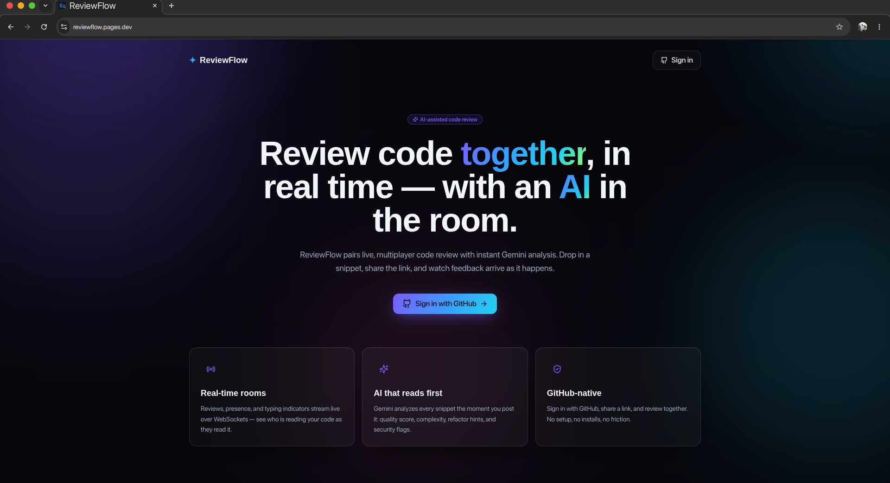
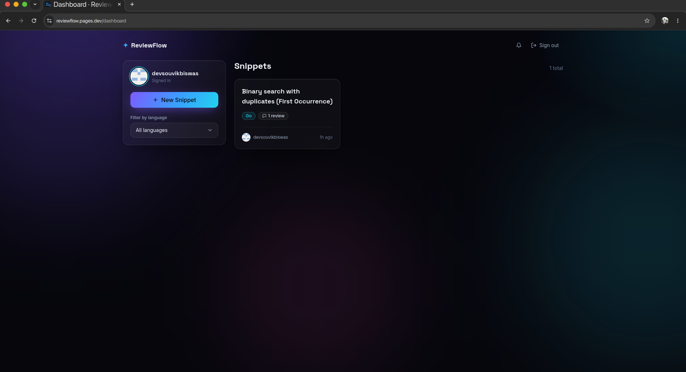
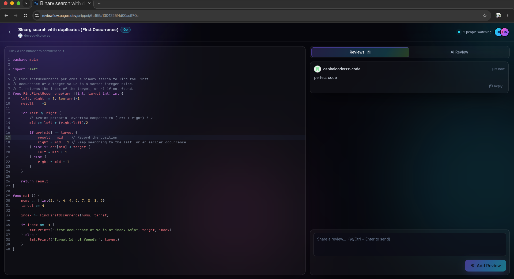

# ReviewFlow

> Real-time, multiplayer code review with an AI in the room.

Drop in a snippet, share the link, and watch reviews stream in live while
Google Gemini analyses the code in the background.

**Stack:** Svelte 5 (SvelteKit) · **Go (Gin)** · GraphQL (gqlgen) · WebSocket
(gorilla) · MongoDB · Gemini.

| Landing | Dashboard | Snippet |
| --- | --- | --- |
|  |  |  |

---

## Try it in two minutes

You need Docker. No GitHub app and no API key are required to see it work.

```bash
cd reviewflow
cp .env.example .env          # optional: add GEMINI_API_KEY for AI reviews
docker compose up --build
```

Open <http://localhost:5173>, type a name, press **Continue as guest**.
To see the real-time part, open a **second browser window** (or a private
window), sign in with a different name, and open the same snippet link: reviews,
typing indicators, presence and AI results appear in both windows instantly.

### Without Docker

```bash
# 1. MongoDB on localhost:27017 (any way you like), e.g.
docker run -d -p 27017:27017 mongo:7

# 2. Backend (Go 1.22+)
cd reviewflow
cp .env.example .env
cd server
make setup        # go mod tidy: resolves dependencies, writes go.sum (once)
make run          # reads ../.env automatically

# 3. Frontend (Node 20+), in another terminal
cd reviewflow/web
npm install
npm run dev       # http://localhost:5173, proxies the API to :8080
```

### Single-process mode

`npm run build` in `web/`, then start the server with
`STATIC_DIR=../web/build`. The Go binary serves the app and the API on one port.

---

## Signing in

| Method | Setup | Use it for |
| --- | --- | --- |
| **Guest** | none (`ALLOW_GUEST_LOGIN=true`, the dev default) | trying it out, demos, two-window testing |
| **GitHub OAuth** | create an OAuth app, set `GITHUB_CLIENT_ID/SECRET` | real deployments |

Guest names are unprotected (anyone can claim any name), so guest login is **off
by default in production**. The landing page shows whichever methods the server
has enabled (`GET /auth/config`).

GitHub OAuth app settings for local use:
*Homepage* `http://localhost:5173`, *Callback*
`http://localhost:8080/auth/github/callback`.

## AI reviews (Gemini)

1. Get a free key at <https://aistudio.google.com/apikey>.
2. Put it in `.env` as `GEMINI_API_KEY` and restart the server.

Model IDs get retired quickly: `gemini-2.0-flash` shut down on 2026-06-01 and
`gemini-2.5-flash` was scheduled for 2026-10-16. The default is
`gemini-3.5-flash`; **if a review fails with "model not found", set
`GEMINI_MODEL`** to a current ID (see <https://ai.google.dev/gemini-api/docs/models>).
Failures are shown in the UI with the reason and a **Retry** button (author
only), so you never stare at an endless spinner. Without a key, everything
except AI reviews works and the panel says so.

---

## How the backend works

```
 browser ──GraphQL──▶ Gin ──▶ gqlgen resolvers ──▶ MongoDB
    ▲                              │
    │ typed WS frames              ├─▶ Hub.BroadcastToRoom ─┐
    └──────────────────────────────┼────────────────────────┘
                                   └─▶ notification row      (no message broker)
                   AI queue ─▶ rate limiter ─▶ Gemini ─▶ upsert ─▶ Hub
```

**WebSocket hub** (`internal/ws`). One goroutine, `Hub.Run()`, owns every room.
Everything reaches it over three channels (`register`, `unregister`,
`broadcast`). The room map is guarded by an `RWMutex`: only `Run()` writes it;
other goroutines (health check, tests) take read locks for consistent
snapshots. Only `Run()` ever sends on or closes a client's `send` channel, which
removes the usual send-on-closed-channel panic. Each client has a bounded
256-frame buffer; fan-out is non-blocking, and a client that falls behind is
**evicted** instead of stalling the room. Presence is per user (several tabs
collapse into one), and typing frames are re-stamped server-side so a client
cannot impersonate another.

**GraphQL linked to the hub** (`internal/graph`). `addReview` persists the
review in MongoDB, pushes a typed `review_added` frame to everyone viewing that
snippet, and records a notification for the author, all in one mutation. Replies
are flattened to one level. gqlgen binds straight to the structs in
`internal/domain`, so there are no field resolvers and list pages cost a fixed
number of queries.

**Gemini pipeline** (`internal/ai`). `createSnippet` saves and returns
immediately; a worker pool does the rest: a `x/time/rate` limiter (10 requests
per minute, spaced evenly) that **waits**, a 30 s budget, `application/json`
response mode plus a schema in the system prompt, strict validation (score is an
integer 1-10, lists capped), one retry on quota exhaustion honouring the API's
`retryDelay`, and an idempotent upsert keyed by `snippetId`. Reviews that were
queued when the server stopped are re-queued on boot.

### Layout

```
reviewflow/
  server/            Go backend
    cmd/server       main: wiring + graceful shutdown
    internal/
      config  auth  store  ws  ai  graph  api  domain
  web/               SvelteKit SPA
  docker-compose.yml        dev stack (Mongo + Go + Vite)
  docker-compose.prod.yml   Caddy + Go (distroless) + Mongo
```

### Endpoints

| | |
| --- | --- |
| `POST /graphql` | queries `snippet`, `snippets`, `me`; mutations `createSnippet`, `addReview`, `retryAIReview` |
| `GET /ws/:snippetID` | WebSocket room (`?token=` JWT) |
| `GET /auth/config` · `POST /auth/guest` · `GET /auth/github[/callback]` · `GET /auth/me` · `POST /auth/logout` | auth |
| `GET /notifications` · `POST /notifications/read` | bell |
| `GET /health` | liveness + DB status |
| `GET /graphql/playground` | dev only |

---

## Configuration

All via environment variables or `reviewflow/.env` (see `.env.example`).

| Variable | Default | Notes |
| --- | --- | --- |
| `PORT` | `8080` | |
| `ENVIRONMENT` | `development` | `production` enforces a strong `JWT_SECRET` and disables playground/introspection |
| `MONGO_URI` / `MONGO_DB` | `mongodb://localhost:27017` / `reviewflow` | |
| `JWT_SECRET` | dev placeholder | ≥ 32 chars in production |
| `ALLOW_GUEST_LOGIN` | on in dev, off in prod | |
| `GITHUB_CLIENT_ID` / `_SECRET` / `GITHUB_REDIRECT_URL` | empty | enables GitHub sign-in |
| `FRONTEND_URL` / `CORS_ORIGIN` | `http://localhost:5173` | allowed browser origins |
| `GEMINI_API_KEY` | empty | empty disables AI |
| `GEMINI_MODEL` | `gemini-3.5-flash` | change when a model is retired |
| `AI_REQUESTS_PER_MINUTE` / `AI_TIMEOUT_SECONDS` | `10` / `30` | |
| `STATIC_DIR` | empty | serve the built SPA from the Go binary |

## Tests

```bash
cd reviewflow/server
make test        # hub + AI pipeline (no database needed)
make test-e2e    # also the full end-to-end suite; needs MongoDB on :27017
```

The end-to-end suite starts the real router against MongoDB with a fake Gemini
server and real WebSocket clients: two users join a room, an AI review arrives
over the socket, a review fans out live, the author gets a notification, replies
flatten, bad tokens/origins/snippet ids are refused, a retired model is surfaced
and retried, and a quota error is retried exactly once.

## Production

```bash
cd reviewflow
cp .env.prod.example .env.prod   # fill in domain, JWT_SECRET, GitHub app, Gemini key
docker compose -f docker-compose.prod.yml --env-file .env.prod up -d --build
```

Caddy terminates TLS, serves the SPA and proxies `/graphql`, `/auth/*`, `/ws/*`
and `/notifications` to the Go container.

## Troubleshooting

| Symptom | Fix |
| --- | --- |
| `mongo ping ... connection refused` | start MongoDB, or fix `MONGO_URI` (host: `localhost`; in compose: `mongo`) |
| AI panel says "model not found" | set `GEMINI_MODEL` to a current model |
| AI panel says quota exhausted | free tier is ~15 RPM shared across your key; wait a minute and Retry |
| AI "did not answer within 30s" | raise `AI_TIMEOUT_SECONDS` |
| `missing go.sum entry` | run `make setup` once (needs network) |
| Sign-in button missing | server has neither guest login nor GitHub configured; see `.env` |

## License

MIT, see `LICENSE`.
